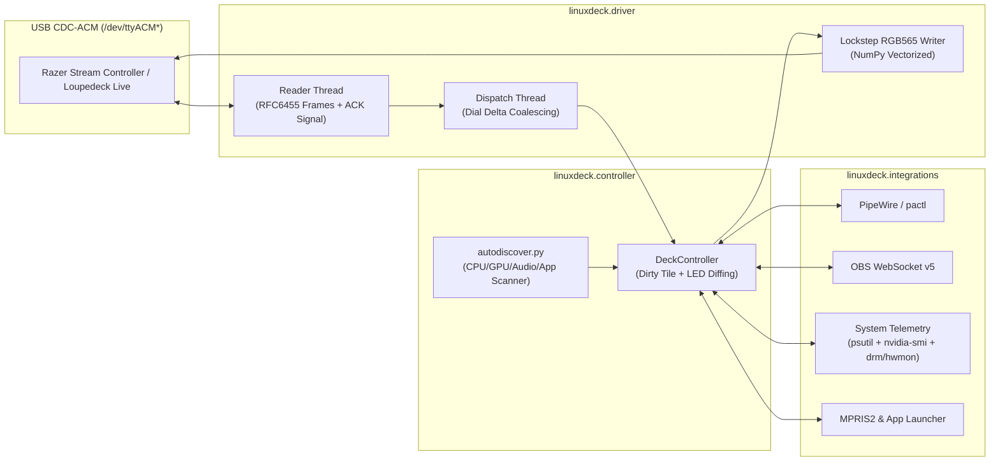

# LinuxDeck

**Open-source Linux driver, hardware auto-configurer, and PyQt6 Control Center for Loupedeck Live & Razer Stream Controller.**

[](LICENSE)
[](pyproject.toml)
[](#supported-hardware)

**LinuxDeck** brings first-class, low-latency Linux support to the **Razer Stream Controller** and **Loupedeck Live** family of control surfaces. Out of the box, it scans your Linux PC's hardware and installed applications to automatically build a ready-to-use multi-page deck profile tailored to your machine.

---

## ✨ Key Features

- **⚡ Sub-2ms Hardware Serial Driver (`LoupedeckDriver`)**
  - Direct USB CDC-ACM WebSocket-over-serial protocol implementation in pure Python + NumPy (`RGB565` little-endian vector conversion).
  - Lockstep hardware ACK synchronization (`~0.14 ms` command round-trip, `~1.3 ms` dial strip draw, `~2.4 ms` touch tile draw) with zero MCU RX buffer drops.
  - Handles firmware `0.2.14+` trailing handshake memory artifacts automatically.
  - Separate reader, coalesced event dispatcher, and dirty-tile background render threads so button presses, touch keys, and rapid dial turns feel instantaneous.

- **🔍 Automatic Host PC Discovery (`linuxdeck --autoconfig`)**
  - **CPU & Sensors**: Automatically detects AMD (`k10temp`, `zenpower`), Intel (`coretemp`), or ARM CPUs and pairs them with your CPU load/temperature tiles.
  - **GPU Telemetry**: Automatically detects NVIDIA GPUs (via `nvidia-smi`), AMD Radeon GPUs (via `/sys/class/drm/card*/device/gpu_busy_percent` & `hwmon`), and Intel Arc/iGPUs, adapting labels (`VRAM` vs `GTT`) to match your hardware.
  - **Extra Hardware Sensors**: Automatically discovers Corsair PSU (`corsairpsu`) / motherboard (`nct*`, `it87*`) sensors, laptop/handheld batteries (`BAT*`), and NVMe/SATA drive temperatures (`nvme`, `drivetemp`).
  - **Audio Routing (PipeWire & PulseAudio)**: Scans `pactl` for your best studio/USB microphone and primary output sink, plus smart application stream categories (`app:chat`, `app:browser`, `app:game`, `app:music`) that match Discord/Vesktop, Firefox/Chrome/Brave, Steam/Games, and Spotify/Media players automatically—even when launched as Flatpaks.
  - **Installed Software**: Detects native or Flatpak installations of **OBS Studio** (including saved scenes from `~/.config/obs-studio/basic/scenes/*.json` or `~/.var/app/com.obsproject.Studio/...`), **EasyEffects**, **Discord / Vesktop**, browsers, terminal emulators (`konsole`, `ptyxis`, `alacritty`, `kitty`, `gnome-terminal`, etc.), and screenshot tools (`spectacle`, `flameshot`, `grim`, `gnome-screenshot`).

- **🎛️ 4 Built-In Integrations + PyQt6 Control Center**
  1. **OBS Studio WebSocket v5**: Toggle Stream, Record, Replay Buffer, Studio Mode, Virtual Camera, and switch Scenes with live status badges on the touchscreen.
  2. **PipeWire / PulseAudio Mixer**: Assign rotary dials and touch keys to master output, microphone gain, or per-app audio streams with live volume gauge bars and push-to-mute.
  3. **MPRIS2 Media, App Launchers & Macros**: Cross-desktop media controls (`playerctl`, `qdbus6`, `qdbus`, `gdbus`), shell commands, and one-tap app launchers.
  4. **Live System Telemetry**: Real-time CPU, GPU, RAM, VRAM, NVMe, PSU/Battery, and network bandwidth gauges rendered directly on the `480×270` display.

---

## 🖥️ Supported Hardware

| Device | USB `VID:PID` | Display | Touch Keys | Dials | Physical Buttons |
| :--- | :---: | :---: | :---: | :---: | :---: |
| **Razer Stream Controller** | `1532:0d06` | `480×270` (`M`) | 12 (`4×3` @ `90×90`) | 6 (`60×90` side gauges) | 8 RGB (`#0`–`#7`) |
| **Loupedeck Live** | `2ec2:0004` | `480×270` (`M`) | 12 (`4×3` @ `90×90`) | 6 (`60×90` side gauges) | 8 RGB (`#0`–`#7`) |
| **Razer Stream Controller X** | `1532:0d09` | `480×270` (`M`) | 15 (`5×3`) | — | — |
| **Loupedeck Live S** | `2ec2:0006` | `480×270` (`M`) | 15 (`5×3`) | 2 | 4 RGB |
| **Loupedeck CT** | `2ec2:0003` | `480×270` (`M`) | 12 (`4×3` @ `90×90`) | 6 + Center Wheel | 8+ RGB |

---

## 🚀 Installation

Download the latest release from the [**GitHub Releases page**](https://github.com/StreamSG/LinuxDeck/releases/latest):

### Option 1: Debian / Ubuntu / Linux Mint / Pop!_OS (`.deb` Installer)
Installs `/usr/bin/linuxdeck`, the desktop application launcher & icon, `systemd` user service, and `/lib/udev/rules.d/70-linuxdeck.rules` automatically:
```bash
sudo apt install ./linuxdeck_1.0.0_amd64.deb
```
Then launch **LinuxDeck** from your desktop Application Menu or run `linuxdeck`.

### Option 2: Portable Standalone Binary (Any `x86_64` Linux Distro)
No Python or dependencies required — everything (Python, PyQt6, Pillow, NumPy, and drivers) is compiled into a single binary. On first launch, if `/dev/ttyACM*` permissions are locked, it automatically prompts once via Polkit (`pkexec`) to install the udev rules:
```bash
chmod +x LinuxDeck-1.0.0-linux-x86_64
./LinuxDeck-1.0.0-linux-x86_64
```

### Option 3: Install from Source
```bash
git clone https://github.com/StreamSG/LinuxDeck.git
cd LinuxDeck
./install.sh
```
To compile the standalone binary and `.deb` package yourself:
```bash
./scripts/build-release.sh
```

---

## 💻 Usage & CLI Flags

```bash
# Launch the LinuxDeck PyQt6 Control Center + hardware daemon
linuxdeck

# Start minimized in the system tray
linuxdeck --tray

# Run headless hardware daemon only (ideal for servers or minimal WM setups)
linuxdeck --headless

# Re-scan your PC's hardware & apps and regenerate an optimized default profile
linuxdeck --autoconfig

# Enable verbose protocol debugging
linuxdeck --debug
```

### Enable Background Autostart on Login (`systemd`)

```bash
systemctl --user enable --now linuxdeck.service
```

---

## 🧭 Default Auto-Configured Layout

When `linuxdeck --autoconfig` runs (or when you click **✨ Auto-Configure for This PC** in the GUI), it creates 4 pages switched via the bottom physical buttons (`1`–`4`) or horizontal touchscreen swipes:

| Control | Function |
| :--- | :--- |
| **Left Dials `L1`–`L3`** | **Master Output Volume**, **Microphone Input Gain**, **Voice Chat Volume** (`app:chat` — Vesktop/Discord) |
| **Right Dials `R1`–`R3`** | **Browser Volume** (`app:browser`), **Game / Steam Volume** (`app:game`), **Display Brightness** |
| **Button `0` (Circle)** | Cycle Next Page (with haptic pulse) |
| **Buttons `1`–`4`** | Direct Page Select (**Page 1: OBS & Stream**, **Page 2: Audio & EasyEffects**, **Page 3: Media & Apps**, **Page 4: System Telemetry**) |
| **Button `5`** | Quick Hardware Mic Mute |
| **Button `6`** | Quick Master Output Mute |
| **Button `7`** | Play / Pause Media |

---

## 🏗️ Architecture



---

## 🛠️ Troubleshooting

### Controller connects, lights up, or updates screen, but button presses do nothing
Make sure the `70-linuxdeck.rules` udev rule is installed and `ModemManager` is not probing the port:
```bash
sudo ./scripts/install-udev.sh
```
Notice that the rule is prefixed `70-` so it runs **before** `/usr/lib/udev/rules.d/73-seat-late.rules` (which applies the `uaccess` ACL tag).

### OBS Studio buttons show `OBS OFF`
In OBS Studio, open **Tools → WebSocket Server Settings**:
1. Check **Enable WebSocket server**.
2. Set Port to `4455` (and either disable authentication for `localhost` or enter your password in the **LinuxDeck Control Center** top bar).

---

## 📄 License

Released under the [MIT License](LICENSE).
